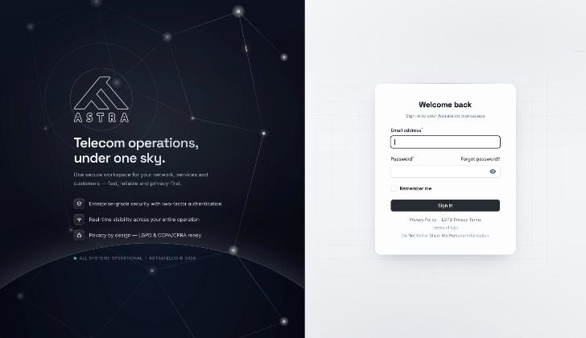
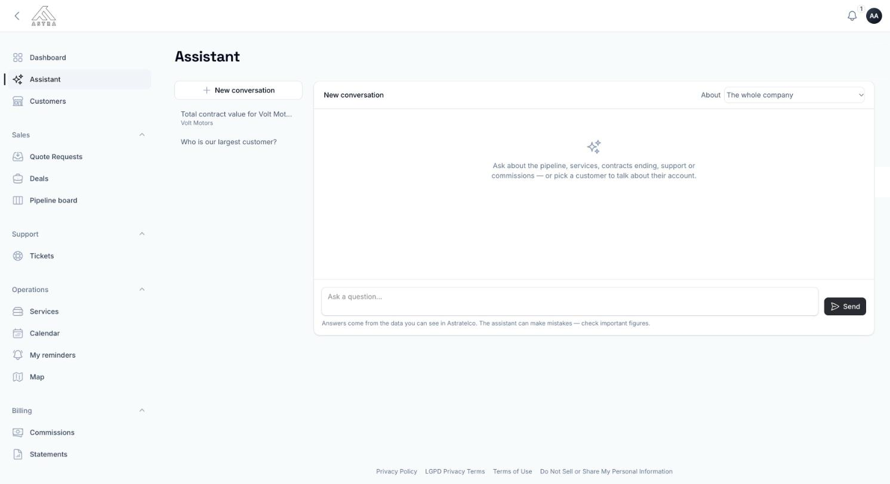
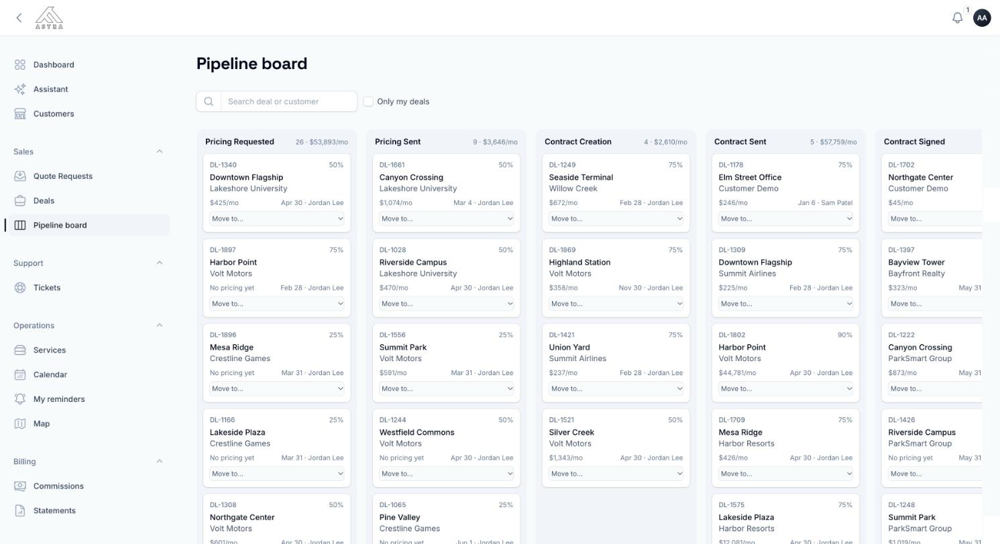
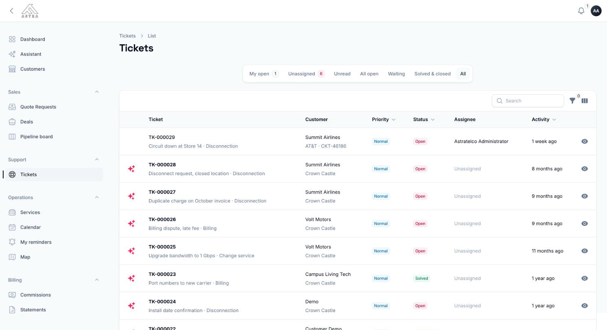
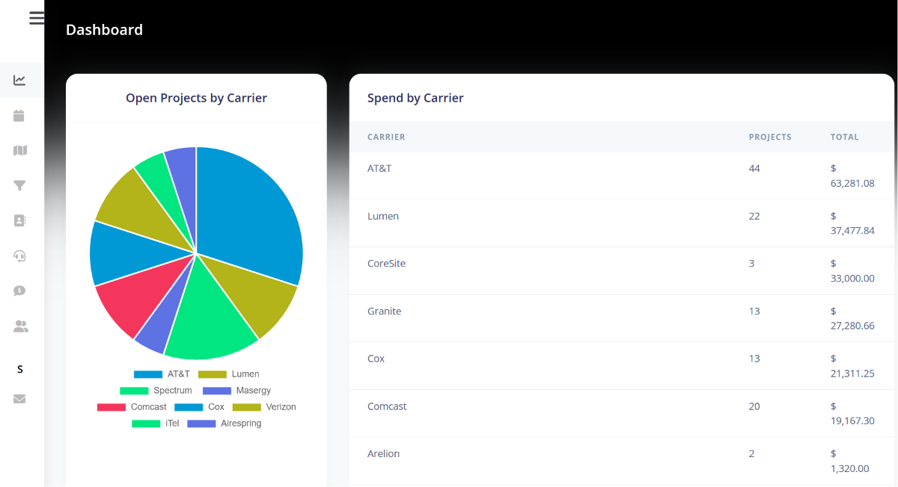
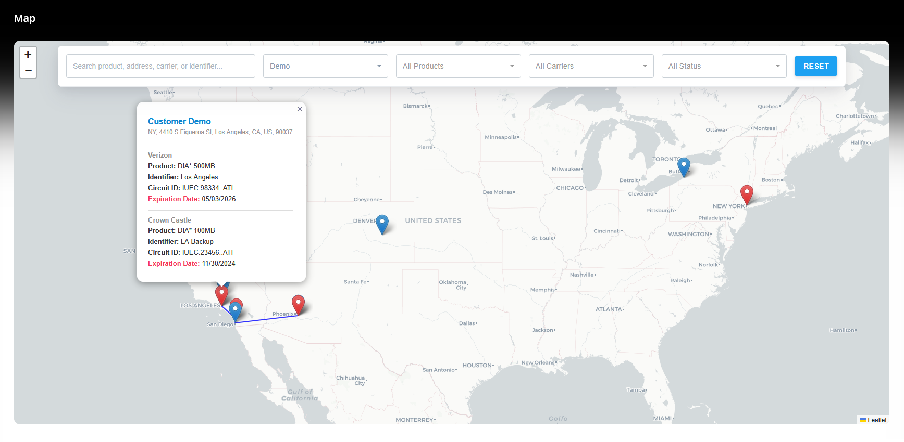

# ASTRA: B2B SaaS Platform Case Study

**Role:** Product Lead
**Company:** Six Play Consulting
**Timeline:** March 2023 to Present
**Status:** Live in production, Version 2.0 (redesigned interface with an AI assistant)

---

## What It Is

ASTRA is a proprietary multi-tenant SaaS platform built to manage the full operational lifecycle of enterprise technology procurement. It integrates CRM, contract management, circuit inventory, quote tracking, support ticketing, and client reporting into a single system.

It replaced a fragmented workflow of spreadsheets, email threads, and disconnected carrier portals across multiple enterprise clients.

---

## The Problem

Six Play Consulting manages complex multi-carrier telecom environments for enterprise clients. Each client had circuits from 5 to 10+ carriers, contracts expiring on different timelines, and no centralized view of spend, status, or risk.

There was no system that could handle all of it. So we built one.

---

## My Role

I owned this product from concept to production with no prior template.

- Designed the full system architecture and user flows before any development began
- Authored all technical requirements and scopes for the engineering team
- Ran agile sprints and managed the development process through to launch
- Led client onboarding including data migrations of 100+ network circuits per customer across multiple carriers
- Built all training materials and ran adoption sessions with clients
- Continued as Product Lead through Version 2.0

---

## Core Modules

**Sales Funnel**
Pipeline management from initial quote through contract execution. Tracks customers, suppliers, probability to close, and anticipated close dates across all active opportunities.

**Inventory Management**
Full circuit inventory with identifier, product type, bandwidth, supplier, address, account number, and carrier circuit ID. Supports multi-currency reporting in USD, EUR, and CAD.

**Quotes**
Quote request tracking by product, bandwidth, location, and P2P requirements. Built-in approval workflow and status tracking from request to resolution.

**Client Dashboard**
Each client sees their own view: pipeline by stage, open projects by carrier, spend breakdown, expiring contracts, and support tickets. Admins can impersonate any client account to provide live support.

**Geographic Map**
Interactive map of all network circuit locations filtered by product, carrier, status, and bandwidth. Gives clients a live view of their infrastructure footprint.

**Support and Ticketing**
Integrated support ticket system tied to specific carriers and products. Tracks billing issues, change requests, and repair tickets with timestamps and open/closed status.

---

## What's New in Version 2.0

Version 2.0 is a full redesign of the interface plus several new modules:

- **AI Assistant:** ask plain language questions about the pipeline, services, contracts ending, support, or commissions, for the whole company or for one customer, with answers grounded in the data the user can see
- **Executive dashboard:** live sales, services, and commission KPIs filterable by period, carrier, currency, and deal owner
- **Pipeline board:** drag and drop deal stages from pricing requested through contract signed, with deal probability and monthly value on every card
- **Ticket inbox:** queue views for my open, unassigned, unread, waiting, and solved tickets, tied to customer, carrier, and circuit
- **Carrier commissions and statements:** tracks expected versus received commissions and flags late or short paid entries
- **Operations tools:** calendar, reminders, and an interactive service map
- **Security and privacy:** two factor authentication, LGPD and CCPA/CPRA ready

---

## Results

- 100% client retention across the full rollout period
- Eliminated manual tracking across spreadsheets and email for all active clients
- Reduced onboarding friction for new clients through structured data migration process
- Platform reached Version 2.0 with expanded analytics and admin tooling

---

## Screenshots

*All screenshots show illustrative data. Client names, sites, people, circuit identifiers, and dollar amounts have been replaced with fictional values.*

### Version 2.0

**Sign in**

**Executive Dashboard**

**AI Assistant**

**Pipeline Board**

**Ticket Inbox**

### Version 1.0

**Dashboard: Pipeline Overview**

**Inventory Report**

**Geographic Circuit Map**

---

## What This Project Demonstrates

- **Taking a product from zero to production:** defined the problem, designed the architecture and user flows, wrote the requirements, and ran delivery with an external engineering team through two major versions
- **Change management and adoption:** migrated each client's full circuit inventory, built training, and ran adoption sessions until teams moved off spreadsheets and carrier portals, reaching 100% client retention
- **Mapping messy enterprise workflows to software:** turned contracts, quotes, tickets, and inventory spread across 5 to 10+ carriers per client into one system with role based client views
- **Applying AI where it earns its place:** added an assistant that answers operational questions in plain language, scoped to the data each user is allowed to see
- **Working across technical and commercial audiences:** translated client needs into engineering scope, then presented build decisions and contract terms to leadership

The same pattern applies to any multi supplier, contract heavy environment, from telecom to energy to enterprise AI deployments: understand the workflow, design the system around it, and drive adoption until it sticks.
